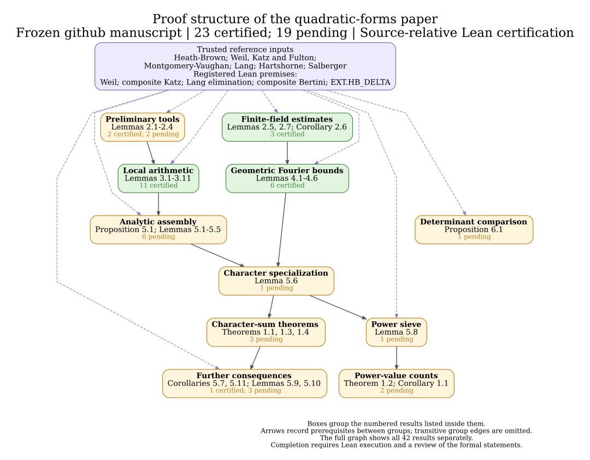

# Character sums over zeros of quaternary quadratic forms

Source-relative Lean verification of the paper by Hemjyoti Nath, Nicolas Robles,
and Alexandru Zaharescu.

The mathematical source is the audited **v35**, copied without content changes as
[quadratic_character_sums_github.tex](manuscript/quadratic_character_sums_github.tex).
The associated [34-page PDF](manuscript/quadratic_character_sums_github.pdf) is
included. The source SHA-256 is

    d4f42a201ae4af89b6884606d94480429a26cfa57332dca6a1547622a3acff33

## Current status

**0 of 42 numbered results are certified; all 42 are Pending.**
The initial dependency review also records 33 auxiliary/supplementary assertion
groups. One supporting finite-sum identity has been checked in Lean; its scope
is stated below. This repository does not yet provide a certificate for the paper.

- [Certification inventory, with links to checked exports](INVENTORY.md)
- [Dependency graphs and the proof structure](DEPENDENCIES.md)
- [Trusted literature inputs and excluded comparison claims](TRUSTED_INPUTS.md)
- [Live proof ledger](certification/status.json)
- [Actual Lean types and axiom dependencies](certification/verification_report.json)
- [Latest execution checkpoint](CHECKPOINT.md)

## Certification scope

Cited literature inputs used in the proofs are trusted. We formalize their
precise interfaces, verify their hypotheses, and prove the manuscript's
deductions. The disputed estimates that this paper corrects are recorded as
comparison targets, not assumptions.

A numbered result is certified only after every clause has a kernel-checked
proof and its formal statement and dependencies have been matched to the
frozen source. Counts refer to numbered results, not supporting declarations.
Supplementary mathematical claims and a final whole-paper correspondence review
are tracked separately.

The first checked helper,
[QuaternaryQuadraticForms.weighted_ray_sum](QuaternaryQuadraticForms/RayAlgebra.lean),
proves the finite algebra behind the last step of (4.5). It does not yet identify
the finite-field Fourier sum with that expression or certify Lemma 4.4.

## Reproduce the checks

The project pins official Lean 4.24.0 and official mathlib4 commit
f897ebcf72cd16f89ab4577d0c826cd14afaafc7, matching the established model projects.
The complete transitive dependency lock is committed.

With the official Lean toolchain manager and Python 3 available:

    lake exe cache get Mathlib.Algebra.BigOperators.Ring.Finset Mathlib.Tactic.Ring
    python3 scripts/verify_certificate.py

The verifier checks the frozen source, every inventory entry, the dependency
graph, toolchain and dependency revisions, local proof modules, actual theorem
types, and axiom dependencies. GitHub Actions runs the same verifier and
publishes its JSON report.

To regenerate the readable inventory and graphs:

    python3 scripts/render_inventory.py
    python3 scripts/build_dependency_graph.py

Graph rendering requires Graphviz. It is not needed to check the Lean proofs.

## First substantive branch

The next work is to define the actual finite-field character sums, prove
projective scaling invariance, and complete the ray identity (4.5).
The polynomial power-sum argument in Lemma 5.9 is a natural subsequent target.
The full dependency inventory determines the other proof branches.
