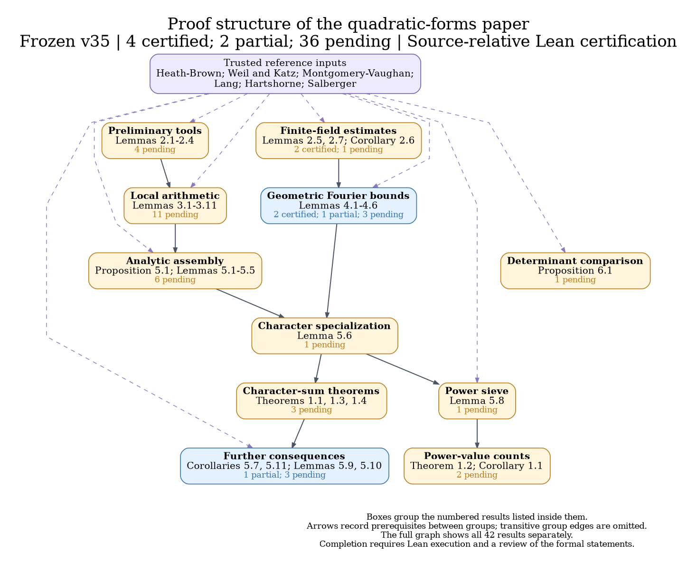

# Character sums over zeros of quaternary quadratic forms

Source-relative Lean verification of the paper by Hemjyoti Nath, Nicolas Robles,
and Alexandru Zaharescu.

The mathematical source is the audited **v35**, copied without content changes as
[quadratic_character_sums_github.tex](manuscript/quadratic_character_sums_github.tex).
The associated [34-page PDF](manuscript/quadratic_character_sums_github.pdf) is
included. The source SHA-256 is

    d4f42a201ae4af89b6884606d94480429a26cfa57332dca6a1547622a3acff33

## Current status

**Complete: 4 · Partial: 2 · Active: 0 · Pending: 36** — 42 numbered results.

**Lemma 2.5 and Corollary 2.6 are Certified relative to the accepted literature
inputs.** Lemma 2.5 is matched to the exact cited univariate Weil estimate.
Corollary 2.6 is proved for the actual projective-line character sum, including
the chart decomposition, polynomial dehomogenization, degree calculation,
distinct-root condition, and contribution at infinity.

**Lemmas 4.2 and 4.3 are now Certified.** Lemma 4.2 constructs one tuple of binary quadratic forms over the
prime field and proves that its coefficient extensions parametrize the actual
conic over every extension field, with independent formal partial derivatives.
Lemma 4.3 deduces the simple-root condition from the manuscript's geometric
rank-three hypothesis and proves the bound for the actual projective section
sum. No restriction that the characteristic be prime to the degree is added.

Lemma 4.4 remains **Partial**: its three weight properties, exact zero-frequency
formula, and intermediate ray identity (4.5) are checked; its pointwise Fourier
bound remains pending. Lemma 5.9 remains **Partial**: integrality and divisibility
of the actual quadratic projective trace are checked; the bound
`|a_p(G)| ≤ 4p` remains pending.

This milestone covers 162 theorem exports and one separate trusted
literature premise across 31 Lean modules. All 33 auxiliary/supplementary groups
remain Pending. This repository does not yet provide a certificate for the
whole paper. The execution checkpoint records the exact scope and evidence
for each verification run.

**The full local verifier passed for this milestone:** all 31 modules, 162
proved exports, the exact literature premise, and 47 recorded input hashes
were checked. GitHub Actions verification for this new scope is pending
publication and will be recorded in the execution checkpoint.

The preceding Weil and projective-line checkpoint passed locally and in
[GitHub Actions](https://github.com/nicolasrobles/quaternary-quadratic-forms/actions/runs/43551946447)
at [proof commit 450ff67](https://github.com/nicolasrobles/quaternary-quadratic-forms/tree/450ff678b56b0a32a76b848278b53ba697958939).
The downloaded CI report and original artifact are preserved in the repository.

- [Certification inventory, with links to checked exports](INVENTORY.md)
- [Dependency graphs and the proof structure](DEPENDENCIES.md)
- [Trusted literature inputs and excluded comparison claims](TRUSTED_INPUTS.md)
- [Live proof ledger](certification/status.json)
- [Actual Lean types and axiom dependencies](certification/verification_report.json)
- [Correspondence review for the Fourier ray identity](certification/correspondence/fourier_rays.md)
- [Correspondence review for quadratic-trace divisibility](certification/correspondence/quadratic_trace.md)
- [Correspondence review for the Weil input](certification/correspondence/weil_input.md)
- [Correspondence review for the projective-line bound](certification/correspondence/projective_weil.md)
- [Correspondence review for the uniform conic parametrization](certification/correspondence/conic_parametrization.md)
- [Correspondence review for the plane-section bound](certification/correspondence/plane_section.md)
- [Latest execution checkpoint](CHECKPOINT.md)

[Full dependency graph (PNG)](docs/dependency_graph.png) ·
[Overview (PNG)](docs/dependency_overview.png) ·
[Full graph as a zoomable PDF](docs/dependency_graph.pdf)

## Certification scope

Cited literature inputs used in the proofs are trusted. We formalize their
precise interfaces, verify their hypotheses, and prove the manuscript's
deductions. The disputed estimates that this paper corrects are recorded as
comparison targets, not assumptions.

A numbered result is certified only after every clause has a kernel-checked
proof and its formal statement and dependencies have been matched to the
frozen source. Counts refer to numbered results, not supporting declarations.
Supplementary mathematical claims and a final whole-paper correspondence review
are tracked separately.

One external premise is registered: the simple-root univariate Weil estimate
from [K, equation (1.2)], specialized to the prime field. Its exact type,
source correspondence, and type hash are inspected separately from proved
exports. The projective-line deductions use this input and the official library;
they are not included among the trusted assumptions. The conic geometry and
transversality deductions are also proved internally. The plane-section
estimate uses the same Weil input through the proved projective-line bound.

## The projective-line estimate

For a nonzero homogeneous binary form of degree `n ≥ 2` with `n` distinct
projective zeros over the algebraic closure, a nonprincipal character `ψ`
satisfying `ψ ^ n = 1` gives

$$\left|\sum_{P\in\mathbf P^1(\mathbf F_p)}\psi(g(P))\right|
\le (n-1)\sqrt p+1.$$

The proof constructs the actual projective charts `(z:1)` and `(1:0)` and
uses the literal polynomial `g(X,1)`. Counting the geometric zeros proves
that its degree is `n` or `n−1`, and that all its roots are distinct. This
supplies every hypothesis of the registered Weil input. The point at infinity
has a character value of norm at most one.

| Module | Checked contribution |
|---|---|
| [ProjectiveLine](QuaternaryQuadraticForms/ProjectiveLine.lean) | Actual projective charts, the sum decomposition, and the corresponding zero-set equivalence |
| [BinaryForms](QuaternaryQuadraticForms/BinaryForms.lean) | Literal substitution, coefficient extension, homogenization recovery, and degree calculation |
| [GeometricRoots](QuaternaryQuadraticForms/GeometricRoots.lean) | Root-count bounds and equivalence with separability over the algebraic closure |
| [BinaryFormRoots](QuaternaryQuadraticForms/BinaryFormRoots.lean) | Derivation of the positive affine degree and simple-root condition from the projective geometric roots |
| [WeilBound](QuaternaryQuadraticForms/WeilBound.lean) | Lemma 2.5 as an exact application of the separately [registered literature premise](QuaternaryQuadraticForms/Trusted/Weil.lean) |
| [ProjectiveWeil](QuaternaryQuadraticForms/ProjectiveWeil.lean) | Complete Corollary 2.6 under the literal manuscript hypotheses |

## The conic and plane-section estimates

For a good prime `p ∤ 2 |det A|` and `F*(u) ≠ 0`, Lemma 4.2 constructs a
single tuple `μ` of binary quadratic polynomials over `ZMod p`. For every field
extension `k`, the same polynomials, with their coefficients mapped to `k`, give
a bijection from `P¹(k)` onto the projective points satisfying
`F(x) = u · x = 0`. The two vectors of formal partial derivatives of `μ` are
linearly independent at every nonzero parameter vector, including over the
algebraic closure.

The construction proves the existence of an isotropic vector and a basis in
which the restricted form is `y₀ y₁ + a y₂²`, with `a ≠ 0`. In that basis the
parametrization is `(-a s², t², st)`. Its embedding into four coordinates,
polynomial identities, and compatibility with every field extension are
proved. The projective equivalence is tied to the evaluation of these actual
coordinate polynomials on every representative.

For Lemma 4.3, the hypothesis is the literal rank-three condition on
`(∇F(x), ∇G(x), u)` at every nonzero geometric common zero. The formal chain
rule and the independent derivative vectors show that `G ∘ μ` cannot have a
singular projective zero. The degree-`2n` binary form therefore has exactly
`2n` distinct geometric projective zeros. This argument uses Euler's identity
without dividing by the degree, so it also covers characteristics dividing
`n` or `2n`.

Transporting the actual section trace along the constructed bijection and
applying Corollary 2.6 gives

$$\left|\sum_{\substack{P\in\mathcal Q(\mathbf F_p)\\u\cdot P=0}}
\psi(G(P))\right|\le (2n-1)\sqrt p+1.$$

Representative independence is proved from homogeneity and `ψ ^ n = 1`.
The final theorem starts from the manuscript's integral symmetric matrix,
good-prime condition, and geometric transversality hypothesis; it constructs
the required parametrizations inside the proof.

| Module | Checked contribution |
|---|---|
| [QuadraticPlane](QuaternaryQuadraticForms/QuadraticPlane.lean), [ConicNormalForm](QuaternaryQuadraticForms/ConicNormalForm.lean) | Nondegeneracy and isotropy of the plane restriction, and the ternary hyperbolic basis |
| [ConicCharts](QuaternaryQuadraticForms/ConicCharts.lean), [ConicPolynomials](QuaternaryQuadraticForms/ConicPolynomials.lean) | Actual projective bijection for the canonical conic, homogeneous coordinates, and formal derivatives |
| [ScalarExtension](QuaternaryQuadraticForms/ScalarExtension.lean), [GoodPrime](QuaternaryQuadraticForms/GoodPrime.lean) | Extension of the fixed coordinates to every field, and reduction under the exact good-prime condition |
| [PlaneConic](QuaternaryQuadraticForms/PlaneConic.lean), [EmbeddedConic](QuaternaryQuadraticForms/EmbeddedConic.lean) | The literal projective plane section, its polynomial parametrization, and the defining polynomial identities |
| [ConicParametrization](QuaternaryQuadraticForms/ConicParametrization.lean) | Complete Lemma 4.2, including one tuple valid over every extension field |
| [PolynomialChainRule](QuaternaryQuadraticForms/PolynomialChainRule.lean), [TransversePullback](QuaternaryQuadraticForms/TransversePullback.lean), [TransversalityRank](QuaternaryQuadraticForms/TransversalityRank.lean) | Formal differentiation of the pullback and conversion of the literal rank-three hypothesis to the tangent-space contradiction |
| [BinaryNonsingular](QuaternaryQuadraticForms/BinaryNonsingular.lean) | Distinct geometric projective zeros, including infinity, with no characteristic-degree restriction |
| [PlaneSectionBound](QuaternaryQuadraticForms/PlaneSectionBound.lean), [PlaneSectionTheorem](QuaternaryQuadraticForms/PlaneSectionTheorem.lean) | Transport of the literal character sum and complete Lemma 4.3 under the manuscript hypotheses |

## Checked finite-field branch

The formalization uses four-coordinate vectors over `ZMod p`, the quadratic
form `xᵀ A x`, actual homogeneous multivariate polynomials, multiplicative
characters extended by zero, and the standard complex additive character.
Projective points are mathlib's quotient by nonzero scalar multiplication.
The quadric, hyperplane condition, and weight are proved independent of the
chosen representative.

| Module | Checked contribution |
|---|---|
| [PolynomialWeights](QuaternaryQuadraticForms/PolynomialWeights.lean) | Polynomial scaling, reduction of integral coefficients, and all three weight properties in (3.1) |
| [FiniteCharacters](QuaternaryQuadraticForms/FiniteCharacters.lean) | The additive-character sum over nonzero scalars: `p − 1` at zero and `−1` otherwise |
| [ProjectiveRays](QuaternaryQuadraticForms/ProjectiveRays.lean) | A proved parametrization of nonzero vectors by projective points and field units, and the resulting sum decomposition |
| [RayAlgebra](QuaternaryQuadraticForms/RayAlgebra.lean) | Finite algebra combining the ray contributions |
| [FourierRays](QuaternaryQuadraticForms/FourierRays.lean) | The literal identity (4.5), its zero-frequency case, and specialization to integral input data |
| [MatrixPolynomial](QuaternaryQuadraticForms/MatrixPolynomial.lean) | A homogeneous polynomial representing `xᵀ A x`, with its degree bound proved |
| [QuadraticCharacter](QuaternaryQuadraticForms/QuadraticCharacter.lean) | Identification of the integer quadratic character, its complex cast, and the Legendre symbol |
| [AffineDivisibility](QuaternaryQuadraticForms/AffineDivisibility.lean) | Divisibility of the integer affine character sum, using polynomial-sum vanishing over the prime field |
| [QuadraticTrace](QuaternaryQuadraticForms/QuadraticTrace.lean) | Integrality and divisibility of the actual projective trace, including integral input coefficients |

Writing `a` for the projective trace and `a_u` for the hyperplane-section trace,
the checked identity is

$$C_p(u)=p a_u-a,$$

including `a_0 = a`, hence $C_p(0)=(p-1)a$. Reduction of an integral frequency
is proved to be zero exactly when `p` divides each coordinate.

These identities require only positive degree and `ψ ^ n = 1`; nonsingularity,
smoothness, and nonprincipality are unnecessary for this part of the proof.
The manuscript's hypotheses therefore specialize the checked results. The
remaining clause of Lemma 4.4 is the bound involving the exceptional polynomial
`D_p`, including its generic and exceptional frequency cases. The
[correspondence record](certification/correspondence/fourier_rays.md) separates
the completed clauses from those obligations.

## Quadratic-trace divisibility

For an odd prime and a quadratic homogeneous `G`, the checked branch proves

$$a_p(G)\in\mathbb Z,\qquad p\mid a_p(G).$$

The trace is first constructed as an integer sum of quadratic-character
values, then its complex cast is identified with the projective trace already
used in the Fourier identities. Euler's criterion and mathlib's polynomial-sum
vanishing theorem show that the affine trace is zero modulo `p`. The checked
identity `C_p(0) = (p-1)a_p(G)` then gives projective divisibility.

This argument needs neither nonsingularity nor smoothness. Those hypotheses
belong to the separate size estimate in Lemma 5.9, which is still pending.
The [correspondence review](certification/correspondence/quadratic_trace.md)
records the exact integer and complex statements and their specialization to
the manuscript.

## Reproduce the checks

The project pins official Lean 4.24.0 and official mathlib4 commit
f897ebcf72cd16f89ab4577d0c826cd14afaafc7, matching the established model projects.
The complete transitive dependency lock is committed.

With the official Lean toolchain manager and Python 3 available:

    lake exe cache get \
      Mathlib.Algebra.BigOperators.Ring.Finset \
      Mathlib.Tactic.Ring \
      Mathlib.Analysis.SpecialFunctions.Complex.CircleAddChar \
      Mathlib.Data.Fintype.BigOperators \
      Mathlib.LinearAlgebra.Projectivization.Cardinality \
      Mathlib.Analysis.Complex.Basic \
      Mathlib.NumberTheory.DirichletCharacter.Bounds \
      Mathlib.RingTheory.MvPolynomial.Homogeneous \
      Mathlib.Data.Matrix.Mul \
      Mathlib.FieldTheory.ChevalleyWarning \
      Mathlib.NumberTheory.LegendreSymbol.Basic \
      Mathlib.Algebra.Polynomial.Homogenize \
      Mathlib.Data.Fin.VecNotation \
      Mathlib.FieldTheory.IsAlgClosed.AlgebraicClosure \
      Mathlib.Algebra.MvPolynomial.PDeriv \
      Mathlib.LinearAlgebra.Basis.VectorSpace \
      Mathlib.LinearAlgebra.BilinearForm.Orthogonal \
      Mathlib.LinearAlgebra.Dual.Lemmas \
      Mathlib.LinearAlgebra.FiniteDimensional.Lemmas \
      Mathlib.LinearAlgebra.LinearIndependent.Basic \
      Mathlib.LinearAlgebra.LinearIndependent.Lemmas \
      Mathlib.LinearAlgebra.Matrix.Adjugate \
      Mathlib.LinearAlgebra.Matrix.BilinearForm \
      Mathlib.LinearAlgebra.Matrix.Dual \
      Mathlib.LinearAlgebra.Matrix.Rank \
      Mathlib.RingTheory.MvPolynomial.EulerIdentity \
      Mathlib.Tactic.FieldSimp
    python3 scripts/verify_certificate.py

The verifier checks the frozen source, every inventory entry, the dependency
graph, toolchain and dependency revisions, local proof modules, actual theorem
types, and axiom dependencies. GitHub Actions runs the same verifier and
publishes its JSON report.

To regenerate the readable inventory and graphs:

    python3 scripts/render_inventory.py
    python3 scripts/build_dependency_graph.py

Graph rendering requires Graphviz. It is not needed to check the Lean proofs.

## Next proof branch

The next target is the exact Katz literature interface and its geometric
specialization in Lemma 2.7. The resulting global trace estimate is needed to
complete the remaining size clause `|a_p(G)| ≤ 4p` in Lemma 5.9.

The exceptional-polynomial construction in Lemma 4.1 and the pointwise Fourier
bound in Lemma 4.4 remain separate proof obligations. Completing the
plane-section estimate supplies one of their needed inputs; it does not
certify the exceptional-plane construction or the remaining Fourier argument.
